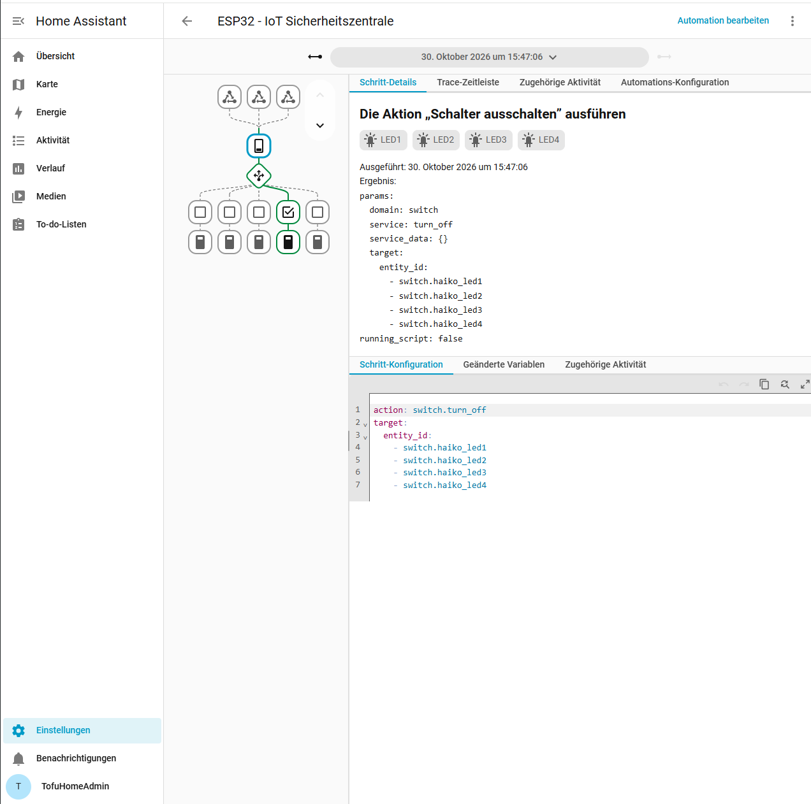

Automatistation erstellt
========================

.. important::
   Eine etwas aufwändigere Autmatisation erstellt. Z.B.
   Wenn ich Taste A drücke leuchtet die grüne Led, wenn ich Taste B drücke die rote und wenn ich beide drücke die Blaue, (Video erstellen) und dann in HA in der Automatisation die Farben ändern.
   Achtung. Das Programm auf dem ESP bleibt gleich.&nbsp; Warum funktioniert das?

IoT-Sicherheitszentrale mit Home Assistant
------------------------------------------

Für diese Aufgabe habe ich in Home Assistant eine eigene Automation namens
``ESP32 - IoT Sicherheitszentrale`` erstellt. Sie verwendet den bereits über
ESPHome eingebundenen ESP32 ``haiko``. Anders als beim Beispiel mit zwei
Tastern berücksichtigt meine Automation zusätzlich die Temperatur und kennt
drei Alarmstufen.

Die Zuordnung ist wie folgt vorgesehen:

.. list-table:: Alarmstufen und Bedienung
   :header-rows: 1
   :widths: 55 45

   * - Situation
     - Reaktion
   * - Temperatur unter 25 °C
     - Grün (LED2)
   * - Temperatur ab 25 °C und unter 30 °C
     - Gelb (LED4)
   * - Temperatur ab 30 °C
     - Rot (LED1)
   * - K1 aktiv
     - Blau (LED3) als Quittierungsanzeige
   * - K2 aktiv
     - Rot (LED1) als Testalarm

Die Tasterzweige haben Vorrang vor den Temperaturstufen. Die Automation wird
bei einer Zustandsänderung des Temperatursensors oder eines Tasters gestartet.
Dabei werden zunächst alle vier LED-Schalter ausgeschaltet und anschliessend
entsprechend den Bedingungen wieder eingeschaltet.

YAML-Konfiguration in Home Assistant
------------------------------------

Die folgende Automation wurde im YAML-Editor von Home Assistant angelegt.
Die beiden Temperaturgrenzen sind als Variablen definiert, sodass sie in
Home Assistant geändert werden können, ohne den ESP32 erneut zu flashen.

.. code-block:: yaml

   alias: "ESP32 - IoT Sicherheitszentrale"
   description: "Temperaturüberwachung mit Alarmstufen und Tastersteuerung"
   mode: restart

   variables:
     warn_temp: 25
     alarm_temp: 30

   triggers:
     - trigger: state
       entity_id: sensor.haiko_sensor_dht_temperature
       id: temperatur

     - trigger: state
       entity_id: binary_sensor.haiko_button_k1
       id: quittieren

     - trigger: state
       entity_id: binary_sensor.haiko_button_k2
       id: testalarm

   conditions: []

   actions:
     - action: switch.turn_off
       target:
         entity_id:
           - switch.haiko_led1
           - switch.haiko_led2
           - switch.haiko_led3
           - switch.haiko_led4

     - choose:
         - conditions:
             - condition: template
               value_template: >
                 {{ is_state('binary_sensor.haiko_button_k2', 'on') }}
           sequence:
             - action: switch.turn_on
               target:
                 entity_id: switch.haiko_led1

         - conditions:
             - condition: template
               value_template: >
                 {{ is_state('binary_sensor.haiko_button_k1', 'on') }}
           sequence:
             - action: switch.turn_on
               target:
                 entity_id: switch.haiko_led3

         - conditions:
             - condition: template
               value_template: >
                 {{ states('sensor.haiko_sensor_dht_temperature')
                    | float(-999) >= alarm_temp }}
           sequence:
             - action: switch.turn_on
               target:
                 entity_id: switch.haiko_led1

         - conditions:
             - condition: template
               value_template: >
                 {{ states('sensor.haiko_sensor_dht_temperature')
                    | float(-999) >= warn_temp }}
           sequence:
             - action: switch.turn_on
               target:
                 entity_id: switch.haiko_led4

         - conditions:
             - condition: template
               value_template: >
                 {{ states('sensor.haiko_sensor_dht_temperature')
                    | float(-999) > -100 }}
           sequence:
             - action: switch.turn_on
               target:
                 entity_id: switch.haiko_led2

Ausführung und Nachweis
-----------------------

Home Assistant hat die Automation angenommen und eine manuell gestartete
Ausführung in der Ablaufverfolgung (Trace) aufgezeichnet. Der Trace zeigt
den Aufruf von ``switch.turn_off`` für die LEDs und die anschliessende
Auswahl eines Zweigs der ``choose``-Entscheidung. Damit ist die serverseitige
Ausführung der Automationslogik dokumentiert.

   Ablaufverfolgung der in Home Assistant ausgeführten Automation.

.. note::
   Der Trace belegt die Ausführung der Automation, aber noch keinen
   vollständigen Funktionstest aller Taster- und LED-Kombinationen. Auf dem
   ESP32 läuft ausserdem bereits eine lokale temperaturabhängige
   LED-Steuerung, die Home-Assistant-Schaltbefehle übersteuern kann.

Warum bleibt die ESP-Firmware unverändert?
------------------------------------------

ESPHome stellt die Taster und den Temperatursensor über seine native API als
Entitäten in Home Assistant bereit. Home Assistant wertet die Zustände aus,
entscheidet anhand der Automation über die Alarmstufe und sendet
Schaltbefehle an die bereits vorhandenen LED-Entitäten zurück.

Die Entscheidungslogik liegt somit auf dem Home-Assistant-Server und nicht in
neuer Firmware auf dem ESP32. Änderungen der Temperaturgrenzen oder der
LED-Zuordnung in Home Assistant benötigen daher keinen erneuten OTA-Upload.
Die auf dem ESP vorhandene lokale Steuerung bleibt dabei allerdings aktiv.

Videonachweis
-------------

Im Video soll die Auslösung der Automation mit den Tastern beziehungsweise
den Temperaturstufen gezeigt werden. Zusätzlich soll eine geänderte
LED-Zuordnung oder Temperaturgrenze in Home Assistant demonstriert werden,
ohne die Firmware auf dem ESP32 zu verändern.

.. youtube:: v7mlaDf9p24
   :width: 100%
