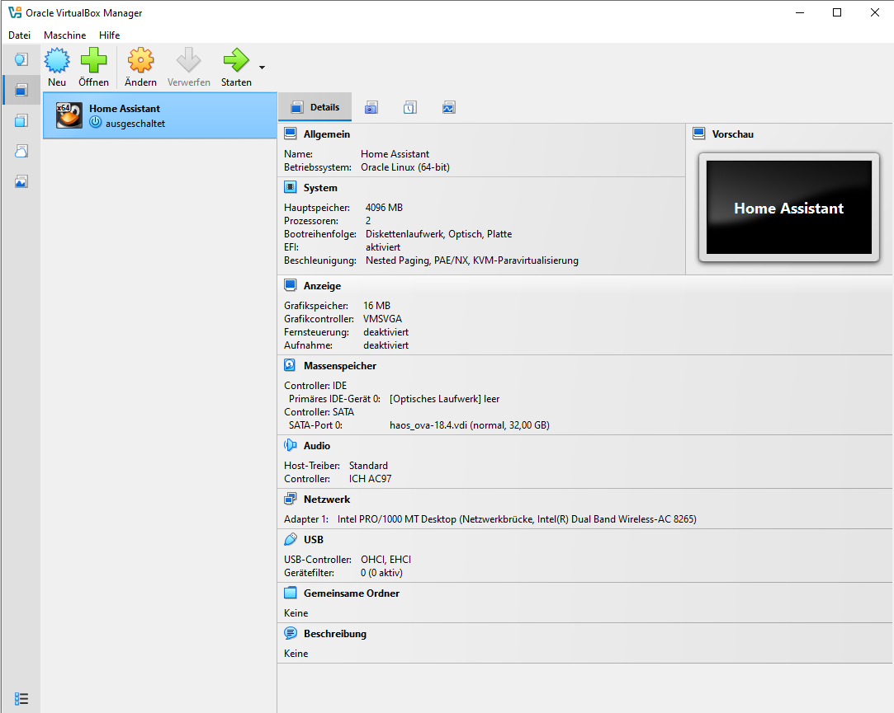
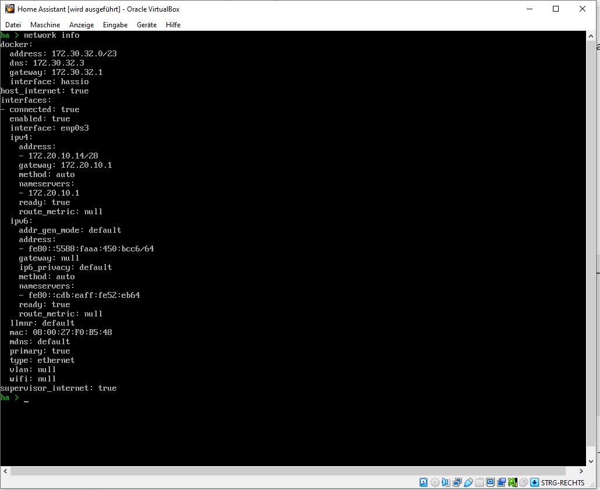
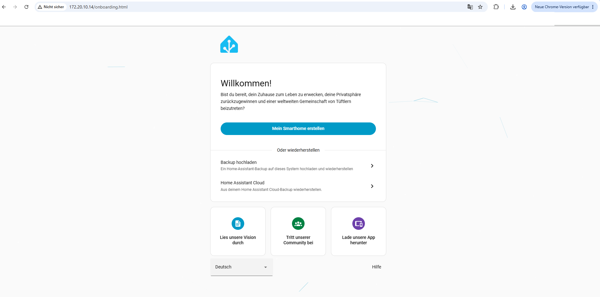
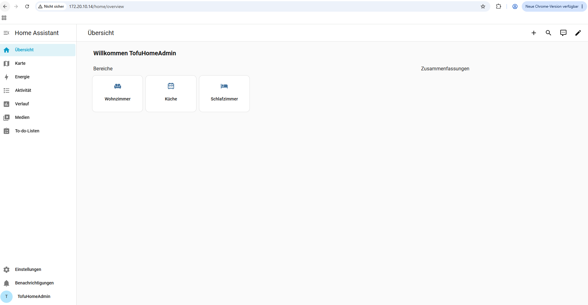
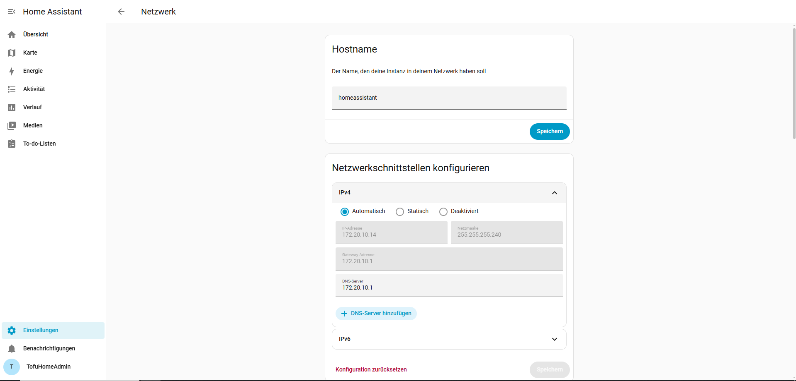

Portfolio HA installiert
========================

.. important::
   Home Assistant auf einem Raspberry Pi oder virtuel installiert und konfiguriert.
   Installation und Konfiguration im Portfolio festgehalten.

Einleitung und Ziel
-------------------

Home Assistant ist eine Open-Source-Plattform zur zentralen Verwaltung und
Automatisierung von Smart-Home- und IoT-Geräten. Über Integrationen lassen sich
Geräte unterschiedlicher Hersteller zusammenführen, überwachen und steuern.
Damit bildet Home Assistant eine Grundlage für die weiteren Arbeiten im
IoT-Modul, beispielsweise mit ESPHome, MQTT und Node-RED.

Ziel dieser Arbeit war es, Home Assistant OS in einer virtuellen Maschine zu
installieren, die Grundkonfiguration vorzunehmen und die Erreichbarkeit der
Weboberfläche nachzuweisen. Die Installation wurde erfolgreich durchgeführt.

Wahl der Installationsart
------------------------

Home Assistant lässt sich unter anderem auf einem Raspberry Pi oder als
virtuelle Maschine betreiben. Ich habe Home Assistant OS in Oracle VirtualBox
unter Windows 10 installiert. Diese Installationsart bietet die Verwaltung
zusätzlicher Apps (in älteren Unterrichtsunterlagen «Add-ons» genannt), die bei
einer reinen Home-Assistant-Containerinstallation nicht enthalten ist.

.. list-table:: Verwendete Installationsumgebung
   :header-rows: 1
   :widths: 35 65

   * - Komponente
     - Konfiguration
   * - Host-Betriebssystem
     - Windows 10
   * - Virtualisierungssoftware
     - Oracle VirtualBox
   * - Gastbetriebssystem
     - Home Assistant OS 18.4
   * - Home Assistant Core
     - 2026.10.4
   * - Arbeitsspeicher der VM
     - 4096 MB (4 GB)
   * - Virtuelle Prozessoren
     - 2 vCPUs
   * - Startmodus
     - EFI aktiviert
   * - Virtuelle Festplatte
     - ``haos_ova-18.4.vdi`` (32 GB)
   * - Netzwerkmodus
     - Netzwerkbrücke über den WLAN-Adapter des Laptops
   * - Netzwerkverbindung
     - Mobiler Hotspot mit automatischer IPv4-Konfiguration (DHCP)
   * - IP-Adresse bei der Einrichtung
     - ``172.20.10.14``

Installation von Home Assistant OS
---------------------------------

1. Ich habe Oracle VirtualBox auf meinem Windows-Laptop installiert und das
   Home-Assistant-OS-Abbild für VirtualBox von der offiziellen Webseite
   heruntergeladen und entpackt.

2. In VirtualBox habe ich eine neue virtuelle Maschine mit dem Namen
   ``Home Assistant`` und dem Betriebssystemtyp ``Oracle Linux (64-bit)``
   erstellt. Das heruntergeladene Abbild ``haos_ova-18.4.vdi`` habe ich als
   vorhandene virtuelle Festplatte am SATA-Controller eingebunden.

3. Der VM habe ich 4096 MB Arbeitsspeicher und zwei virtuelle Prozessoren
   zugewiesen. Den EFI-Startmodus habe ich aktiviert.

4. Für den Netzwerkadapter habe ich den Modus ``Netzwerkbrücke`` gewählt.
   Dadurch kann die VM eine eigene IP-Adresse über das verbundene Netzwerk
   beziehen.

5. Anschliessend habe ich die virtuelle Maschine gestartet und Home Assistant
   OS initialisieren lassen.

   Konfiguration der virtuellen Maschine in VirtualBox mit zwei Prozessoren,
   4096 MB RAM, aktiviertem EFI, eingebundener VDI-Festplatte und Netzwerkbrücke.

Netzwerkproblem und erster erfolgreicher Start
---------------------------------------------

Beim ersten Start über das Schul-WLAN erhielt Home Assistant keine
IPv4-Adresse. Die Netzwerkanzeige meldete für ``enp0s3`` zunächst
``(No address)``; der Internetzugriff war nicht verfügbar. Nach dem Wechsel
meines Windows-Laptops auf einen mobilen Hotspot konnte die virtuelle Maschine
mit unverändertem Netzwerkbrücken-Modus über DHCP eine Adresse beziehen.

Die erfolgreiche Netzwerkprüfung zeigte die IP-Adresse ``172.20.10.14/28``,
das Gateway ``172.20.10.1`` sowie die Zustände ``ready: true`` und
``supervisor_internet: true``. Damit war die Netzwerkverbindung hergestellt.

   Erfolgreiche Netzwerkkonfiguration von Home Assistant OS über einen mobilen
   Hotspot. Die VM erhielt die IPv4-Adresse ``172.20.10.14``.

Erstkonfiguration über die Weboberfläche
---------------------------------------

Nach der Netzwerkkonfiguration konnte ich Home Assistant im Browser über die
lokale Adresse ``http://172.20.10.14:8123/`` aufrufen. Die allgemeine
Standardadresse lautet ``http://homeassistant.local:8123/``, sofern die
Namensauflösung im Netzwerk funktioniert.

Ich habe den Einrichtungsassistenten geöffnet, ein Administratorkonto mit dem
Benutzernamen ``TofuHomeAdmin`` eingerichtet und die Standort- sowie
Grundeinstellungen durchlaufen. Das Passwort wurde aus Sicherheitsgründen
nicht im Portfolio festgehalten. Im Benutzerprofil ist Deutsch als Sprache
ausgewählt; für die Zeitanzeige ist die lokale Zeitzone eingestellt.

Während der Ersteinrichtung traten vorübergehend Systemverzögerungen und
Kernel-Warnungen (unter anderem ``rcu_preempt``) auf. Nach einem Neustart
konnte der Einrichtungsassistent fortgesetzt und abgeschlossen werden. Die
genaue Ursache der Warnungen konnte nicht abschliessend nachgewiesen werden.

   Erfolgreicher Aufruf des Einrichtungsassistenten über die lokale IP-Adresse
   ``172.20.10.14``.

Nach Abschluss der Einrichtung konnte ich mich anmelden und das
Home-Assistant-Dashboard öffnen. Der Benutzer ``TofuHomeAdmin`` wird dort
angezeigt. Im Profil ist das Konto als Eigentümer gekennzeichnet.

   Erfolgreich eingerichtetes Home-Assistant-Dashboard mit angemeldetem
   Benutzer ``TofuHomeAdmin``.

Netzwerk und grundlegende Einstellungen
--------------------------------------

Die Netzwerkdaten habe ich unter ``Einstellungen → System → Netzwerk``
überprüft. Während der Einrichtung waren folgende Werte gesetzt:

.. list-table:: Überprüfte Netzwerkeinstellungen
   :header-rows: 1
   :widths: 35 65

   * - Einstellung
     - Wert
   * - Hostname
     - ``homeassistant``
   * - IPv4-Konfiguration
     - Automatisch (DHCP)
   * - IPv4-Adresse
     - ``172.20.10.14``
   * - Subnetzmaske
     - ``255.255.255.240``
   * - Gateway
     - ``172.20.10.1``
   * - DNS-Server
     - ``172.20.10.1``
   * - Aufruf der Weboberfläche
     - ``http://172.20.10.14:8123/``
   * - Sprache im Benutzerprofil
     - Deutsch
   * - Zeitzone im Benutzerprofil
     - Lokale Zeitzone verwenden
   * - Browserzugriff
     - Erfolgreich

.. note::
   Die IP-Adresse wurde vom mobilen Hotspot per DHCP vergeben und kann sich
   bei einer späteren Verbindung ändern. Eine statische IP-Adresse wurde
   nicht eingerichtet.

   Netzwerkeinstellungen von Home Assistant OS mit automatischer
   IPv4-Konfiguration, IP-Adresse ``172.20.10.14`` und Gateway sowie
   DNS-Server ``172.20.10.1``.

Benutzerrechte und Vorbereitung für den Unterricht
-------------------------------------------------

Die Unterrichtsunterlagen erwähnen das Aktivieren eines «Erweiterten Modus».
In der verwendeten Oberfläche von Home Assistant 2026.10.4 ist dieser
Schalter nicht mehr vorhanden. Das Konto ``TofuHomeAdmin`` ist als
Eigentümer ausgewiesen und verfügt damit über die erforderlichen
Administrationsrechte für die weitere Konfiguration.

Home Assistant OS bildet die Grundlage für die späteren Unterrichtsaufgaben
mit ESPHome, MQTT und Node-RED. Erweiterungen wie Studio Code Server,
ESPHome Device Builder und Samba share können in den folgenden Arbeiten
separat eingerichtet und dokumentiert werden; ihre Installation ist nicht
Bestandteil dieses Portfolioeintrags.

Funktionskontrolle
-----------------

Nach der Installation habe ich die virtuelle Maschine, das Netzwerk und
die Anmeldung an der Weboberfläche überprüft.

.. list-table:: Ergebnis der Funktionskontrolle
   :header-rows: 1
   :widths: 65 35

   * - Prüfschritt
     - Ergebnis
   * - Home Assistant OS startet in VirtualBox
     - Bestanden
   * - VM erhält eine IPv4-Adresse über den Hotspot
     - Bestanden
   * - Home-Assistant-Weboberfläche ist erreichbar
     - Bestanden
   * - Administratorkonto kann verwendet werden
     - Bestanden
   * - Dashboard wird nach der Anmeldung angezeigt
     - Bestanden
   * - Netzwerkdaten wurden in Home Assistant überprüft
     - Bestanden
   * - Dauerhafte Stabilität ohne weitere Kernel-Warnungen
     - Nicht abschliessend geprüft

Fazit und persönliche Reflexion
------------------------------

Ich konnte Home Assistant OS in VirtualBox installieren und die
Weboberfläche erfolgreich konfigurieren. Die grösste Schwierigkeit war die
Netzwerkverbindung: Über das Schul-WLAN bekam die VM keine IPv4-Adresse.
Durch den Wechsel auf meinen mobilen Hotspot erhielt Home Assistant eine
funktionierende DHCP-Konfiguration und war im Browser erreichbar.

Während der Ersteinrichtung kam es zusätzlich zu Systemverzögerungen und
Kernel-Warnungen. Nach einem Neustart konnte ich die Einrichtung fortsetzen
und mich mit meinem Administratorkonto anmelden. Dabei habe ich gelernt,
wie wichtig die Netzwerkkonfiguration, die Kontrolle der Konsolenmeldungen
und eine schrittweise Fehlersuche bei virtuellen IoT-Systemen sind.

Mit dem erreichbaren Dashboard ist die Grundlage für die kommenden Aufgaben
mit ESPHome und weiteren Home-Assistant-Integrationen geschaffen. Ob die
beobachteten Kernel-Warnungen dauerhaft ausbleiben, muss bei der weiteren
Nutzung überprüft werden.

Quellen
-------

* `Home Assistant – Installation <https://www.home-assistant.io/installation/>`_
* `Home Assistant – Installation unter Windows <https://www.home-assistant.io/installation/windows/>`_
* `Home Assistant – Ersteinrichtung <https://www.home-assistant.io/getting-started/onboarding/>`_
