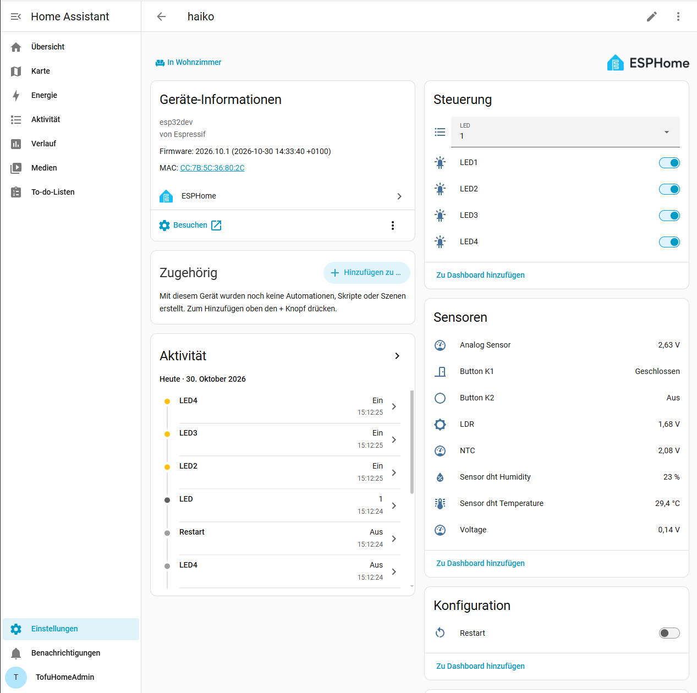

Screenshot ESP - HA - Connected
===============================

.. important::
   ESP und Home Assistant miteinander Verbunden. Konfiguration festhalten via Print Screen im Portfolio

Verbindung des ESP32 mit Home Assistant
--------------------------------------

Nachdem ich die ESPHome-Firmware erfolgreich über Home Assistant auf
meinen ESP32 ``haiko`` übertragen hatte, habe ich den ESP32 auch direkt
in Home Assistant eingebunden.

Dazu habe ich unter ``Einstellungen → Geräte & Dienste → Integrationen``
das automatisch erkannte ESPHome-Gerät ``haiko`` ausgewählt und über
``Hinzufügen`` eingerichtet.

Anschliessend habe ich den Gerätenamen ``haiko`` beibehalten und das
Gerät dem Bereich ``Wohnzimmer`` zugeordnet.

Erfolgreiche Verbindung
-----------------------

Nach der Einrichtung erscheint mein ESP32 ``haiko`` als eigenes Gerät
in Home Assistant. Die Kommunikation erfolgt über die ESPHome-Integration
und die in der ESPHome-Konfiguration aktivierte native API.

Auf der Geräteseite werden die angeschlossenen Sensoren und Aktoren
angezeigt. Dazu gehören unter anderem:

* Vier steuerbare LEDs (LED1 bis LED4)
* DHT-Temperatursensor
* DHT-Luftfeuchtigkeitssensor
* LDR und NTC
* Analoger Sensor
* Taster K1 und K2

Die Werte werden direkt in Home Assistant angezeigt. Ausserdem stehen
die LED-Schalter zur Steuerung zur Verfügung.

   Der ESP32 ``haiko`` wurde erfolgreich über die ESPHome-Integration
   mit Home Assistant verbunden. Auf der Geräteseite sind die
   Sensorwerte und die steuerbaren LEDs sichtbar.

Ergebnis
--------

Die Verbindung zwischen meinem ESP32 ``haiko`` und Home Assistant
wurde erfolgreich hergestellt. Die ESPHome-Integration erkennt das
Gerät und zeigt die Sensoren sowie die verfügbaren Steuerfunktionen
an.

Damit ist der geforderte Verbindungsnachweis erbracht.
