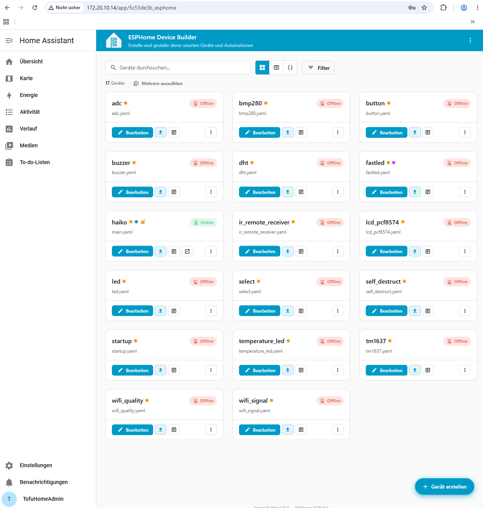
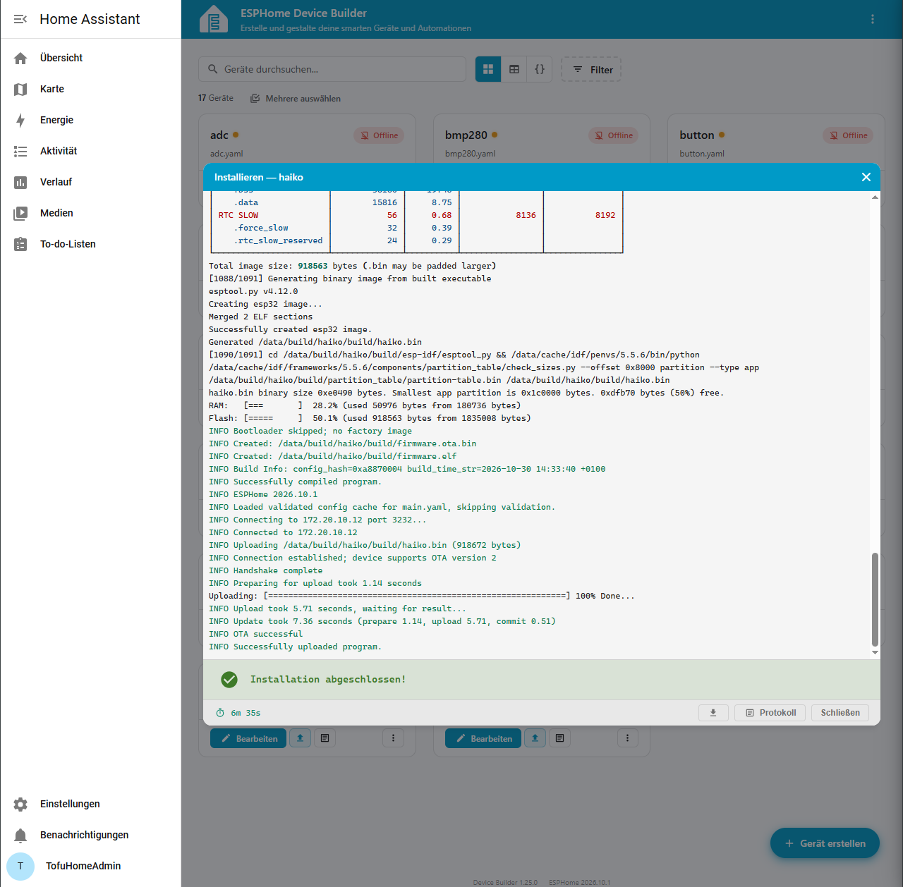

Screenshot HA
=============

.. important::
   Aus dem HA ein Programm auf den ESP geladen

Programmübertragung mit Home Assistant
-------------------------------------

Für diese Aufgabe habe ich meinen bereits eingerichteten ESP32 ``haiko``
und den ESPHome Device Builder in Home Assistant OS (VirtualBox) verwendet.
Der ESP32 ist über ``haiko.local`` im WLAN erreichbar und unterstützt
OTA-Updates (Over the Air).

Die bestehende Konfiguration ``main.yaml`` und ihre eingebundenen YAML-Dateien
habe ich über die Samba-Freigabe in den Ordner ``/config/esphome/`` von
Home Assistant kopiert. Anschliessend wurde ``haiko`` im ESPHome Device
Builder als online angezeigt. Die übernommene Konfiguration habe ich dort
erfolgreich validiert.

   Der ESP32 ``haiko`` wird im ESPHome Device Builder als online angezeigt.

.. figure:: ../../../_static/img/sem4/iot/HA_ESPHome_Validierung.png
   :alt: Erfolgreiche Validierung der ESPHome-Konfiguration für haiko
   :align: center
   :width: 75%

   Die übernommene ESPHome-Konfiguration wurde erfolgreich validiert.

Programm auf den ESP laden
-------------------------

Als kleine, nachvollziehbare Änderung habe ich in ``main.yaml`` den Logger
von ``DEBUG`` auf ``INFO`` umgestellt:

.. code-block:: yaml

   logger:
     level: INFO

Danach habe ich die Konfiguration gespeichert und im ESPHome Device Builder
erneut überprüft. Über die Funktion ``Update`` habe ich die Firmware direkt
in Home Assistant kompiliert und über WLAN (OTA) auf den ESP32 ``haiko``
übertragen.

Das Installationsprotokoll zeigt, dass die Verbindung zum ESP hergestellt
und die Firmware vollständig übertragen wurde. Die entscheidenden Meldungen
lauten ``OTA successful`` und ``Successfully uploaded program``. Zusätzlich
wurde ``Installation abgeschlossen!`` angezeigt.

   Erfolgreiche Firmware-Übertragung aus Home Assistant auf den ESP32
   ``haiko``. Das Installationsprotokoll bestätigt den abgeschlossenen
   OTA-Upload.

Ergebnis
--------

Ich habe die bestehende ESPHome-Konfiguration in Home Assistant übernommen,
validiert und anschliessend eine aktualisierte Firmware über WLAN auf meinen
ESP32 ``haiko`` geladen. Der erfolgreiche OTA-Upload ist durch das
Installationsprotokoll dokumentiert. Damit ist der geforderte Leistungsnachweis
erbracht.
